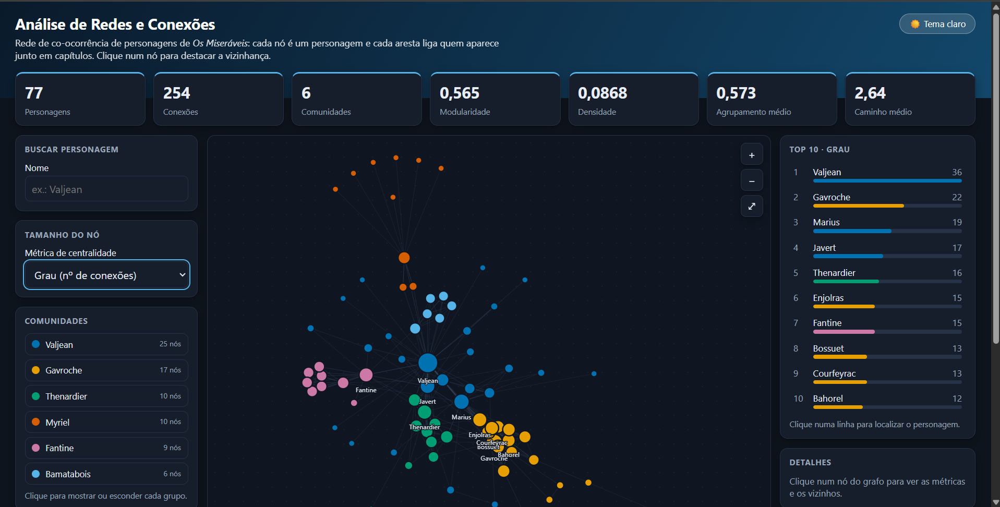

# Análise de Redes e Conexões

Análise de rede social com teoria dos grafos: mapeia conexões, calcula centralidades, detecta comunidades e identifica hubs e pontes.

**Dataset:** co-ocorrência de personagens de *Os Miseráveis* (Knuth, *Stanford GraphBase*, embutido no NetworkX). Nó = personagem; aresta = aparecem no mesmo capítulo; peso = nº de capítulos em comum.

## Estrutura
```
data/       edges_raw.csv, edges_clean.csv
notebooks/  analise_redes.ipynb  (executado, com saídas)
outputs/    figuras PNG, tabelas CSV e dashboard.html
dashboard/  gerar_dashboard.py, modelo_dashboard.html, vendor/
docs/       dashboard.png (imagem usada no README)
tests/      testes de reprodutibilidade e higiene
requirements.txt
```

## Como executar
```bash
py -3 -m venv .venv               # Windows (se "python" abrir a Microsoft Store, use "py")
# python3 -m venv .venv           # Linux/macOS
.venv\Scripts\activate            # Linux/macOS: source .venv/bin/activate
pip install -r requirements.txt
python dashboard/gerar_dashboard.py       # regenera o dashboard
python -m unittest discover -s tests -v   # testes de reprodutibilidade e higiene
```
O notebook já vem executado, com as saídas visíveis. Para reexecutá-lo, instale também o Jupyter (`pip install jupyter`) e use "Run All".

Seeds fixas (`SEED = 42`) e dependências com versões fixadas tornam os resultados reprodutíveis. O Louvain vem de `networkx.community`, sem dependência extra.

## Dashboard interativo


Abra [outputs/dashboard.html](outputs/dashboard.html) no navegador (funciona sem internet e sem servidor):
- **Rede** com tamanho do nó por métrica (grau, intermediação, proximidade, autovetor, PageRank) e cor por comunidade (paleta acessível);
- **Destaque da vizinhança** ao clicar num nó, com painel de detalhes e vizinhos clicáveis;
- **Busca** de personagem, **filtro** por comunidade e botões de zoom;
- **Top 10** com barras para a métrica escolhida;
- **Simulação de remoção de hubs**, comparada com a remoção aleatória;
- **Tema claro e escuro** (segue o tema do sistema por padrão).

Para regenerar (usa só as dependências de `requirements.txt`):
```bash
python dashboard/gerar_dashboard.py
```
A biblioteca de visualização (vis-network, MIT/Apache-2.0) está em `dashboard/vendor/`; veja `THIRD_PARTY.md`.

## Fonte dos dados
Rede de co-ocorrência de personagens de *Os Miseráveis*, de Donald E. Knuth, *The Stanford GraphBase: A Platform for Combinatorial Computing* (1993), distribuída com o NetworkX (`nx.les_miserables_graph()`). Dados públicos, sem informações pessoais. Se for reutilizar os dados, cite a fonte original.

## Licença
Código distribuído sob a [licença MIT](LICENSE). Os dados de *Os Miseráveis* pertencem à fonte original citada acima.

## Segurança
Veja [SECURITY.md](SECURITY.md) para o escopo, as medidas adotadas e como reportar vulnerabilidades.

## Principais resultados
| Item | Resultado |
|---|---|
| Rede | 77 nós, 254 arestas, 1 componente, densidade 0,087 |
| Mundo pequeno | caminho médio 2,64; diâmetro 5; clustering médio 0,57 |
| Hub principal | Valjean (grau 36, intermediação 0,57) |
| Top 5 por grau | Valjean, Gavroche, Marius, Javert, Thénardier |
| Comunidades | 6 (Louvain), modularidade Q = 0,57 |
| Robustez | sem os 20 maiores hubs, 13% dos nós ficam na maior componente (65% se a remoção for aleatória) |

Grau e intermediação medem coisas diferentes: o grupo de estudantes é muito conectado, mas pouco "ponte"; Myriel tem grau moderado e a segunda maior intermediação. Veja os insights completos no notebook.

## Limitações
- Rede de co-ocorrência em capítulos, não de interações sociais reais.
- Só 77 nós: a análise da distribuição de graus é exploratória.
- Louvain é estocástico; a seed fixa garante o mesmo resultado, mas outras seeds podem mudar levemente as comunidades.

## Próximos passos
Análise temporal por parte do livro, previsão de links, dashboard hospedado (GitHub Pages) e aplicação a uma rede social real.
